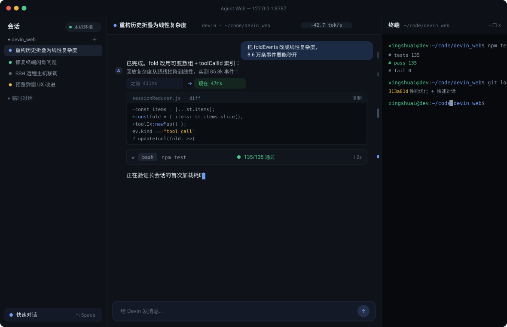
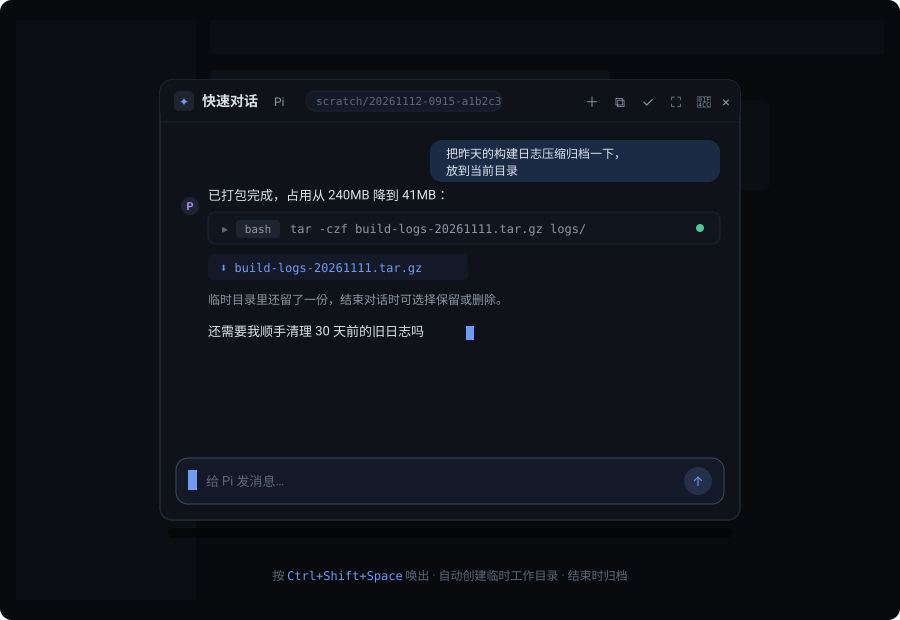
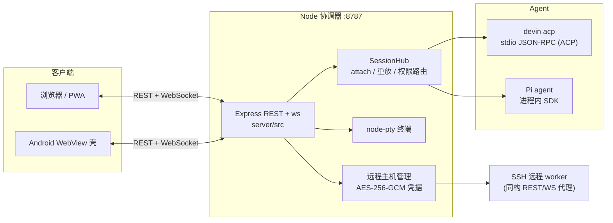

# Agent Web

Devin / Pi agent 的 Web 界面：一个本地 Node 协调器把 `devin acp`（ACP 协议）与 Pi SDK 桥接到浏览器，提供多窗格会话、工作区终端、SSH 远程主机、文件预览和快速对话。支持桌面浏览器、PWA 安装和 Android WebView 壳。

## 效果展示

> 示意图（按真实界面风格绘制，非截图）





## 功能特性

**会话与协作**

- 多 agent 后端：Devin（`devin acp`，stdio JSON-RPC / ACP）与 Pi（进程内 SDK，无需外部进程），新建会话时可选。
- 分屏工作区：任意左右/上下拆分窗格，布局按比例持久化；同一会话不会重复打开。
- 长会话优化：流式 Markdown 只重渲染未完成的尾部块，历史折叠线性复杂度（8.6 万条事件约 47ms），代码高亮在 Worker 中惰性执行，渲染结果 LRU 缓存。
- 会话内全文搜索、消息导航刻度、Markdown 导出、断线重连与缓冲重放、空闲自动分离（attach 上限可配）。

**快速对话（临时会话）**

- `Ctrl+Shift+Space`（可自定义）唤出居中模态框，自动聚焦输入框；默认用 Pi，可在设置中改。
- 每次自动创建独立临时工作目录（`~/.local/share/devin-web/scratch/`，0700），不进工作区列表；隐藏后任务继续跑，入口按钮有状态圆点。
- 结束时归档会话；目录为空自动清理，非空可选择保留/删除文件；任务运行中禁止结束。

**终端与文件**

- 每个窗格可开工作区终端（`Ctrl+\``），node-pty 共享 PTY、有界输出回放、移动端触控按键。
- 文件链接可预览（HTML 沙箱 iframe + 资源代理 + CSP、Markdown、图片、PDF.js、代码/文本高亮）或直接下载（大文件流式传输）；预览/后台任务弹窗可调整大小与最大化，状态持久化。
- 后台任务面板：日志跟随/暂停、停止前确认、耗时与状态显示。

**SSH 远程主机**

- 在远程 Linux 主机上部署同构 worker（SSH/SFTP），本机 UI 统一代理其 REST/WebSocket。
- 远程凭据 AES-256-GCM 加密落盘（密钥由 `DEVIN_WEB_SSH_MASTER_KEY` 注入），SSH 指纹先校验再绑定；检测→确认→部署/装私有 Node 全流程可审计。

**其他**

- 中文/英文界面切换，多套暗色主题，字号/动效偏好，PWA（manifest + service worker），Android WebView 壳（`android/`，versionName 0.4.0）。
- 命令面板（`Ctrl+K`）、可自定义的全局快捷键、通知开关、用量/账户面板。

## 架构



- `server/` — 后端。`index.js` REST+WS，`sessions.js` 会话枢纽，`acp-client.js` Devin 桥，`pi-sdk/` Pi 集成，`terminals.js` PTY，`remote-*.js` SSH 远程，`scratch.js` 临时目录，`file-preview.js` 预览票据。
- `web/` — React 19 + Vite 前端。`App.jsx` 根状态与消息路由，`splitLayout.js`/`SplitWorkspace.jsx` 分屏，`sessionReducer.js` 事件折叠，`layers.js` 模态层栈，`components/` 各面板。
- `android/` — WebView 壳，把应用打进 APK。
- 详细约定见 [AGENTS.md](AGENTS.md)。

## 快速开始

要求：Node ≥ 22.19，npm；Devin 需要已安装并登录 `devin` CLI（`DEVIN_BIN` 可指定路径），Pi 需要 `~/.pi/agent` 配置。

```bash
npm install        # 安装 server + web 工作区依赖
npm run build      # 构建前端到 web/dist（已被 gitignore）
npm start          # http://127.0.0.1:8787
```

或一条命令（自动装依赖、按需构建）：

```bash
./start.sh            # 启动
./start.sh dev        # 开发模式：后端 --watch + vite :5173
PORT=9000 ./start.sh  # 换端口
```

测试：`npm test`（node:test，含本地 PTY/WebSocket 与进程内 Pi SDK 集成测试）。

### 常用环境变量

| 变量 | 说明 |
|---|---|
| `PORT` / `HOST` | 监听地址，默认 `8787` / `127.0.0.1` |
| `DEVIN_WEB_DATA` | 数据目录（state.json、远程凭据），默认 `server/data` |
| `DEVIN_WEB_TOKEN` | 可选 bearer token，保护 `/api` 与 `/ws`；远程/非回环访问必须 |
| `DEVIN_BIN` | `devin` CLI 路径 |
| `DEVIN_WEB_ORIGINS` | 额外允许的 WebSocket Origin |
| `DEVIN_WEB_SCRATCH_DIR` | 快速对话临时目录根，默认 `~/.local/share/devin-web/scratch` |
| `DEVIN_WEB_SSH_MASTER_KEY` | 远程凭据主密钥，32 字节 Base64（`openssl rand -base64 32`） |
| `DEVIN_WEB_TRUST_PROXY` | 可信反代（`loopback` 或精确 IP 列表） |
| `MAX_ATTACHED_SESSIONS` | 每 hub attach 上限，默认 10 |
| `MAX_TERMINALS` | 活动终端上限，默认 8 |

## 安全模型要点

- 终端是**服务器账户的真实 shell，不是沙箱**；agent 命令同样拥有真实权限。
- 无 token 时终端仅接受真正的回环连接 + 回环 Host/Origin + 无代理头；远程/反代访问必须配置 `DEVIN_WEB_TOKEN` 并用 `?token=` 打开。
- 远程凭据落盘即加密（0600），主密钥不落地、不下发 worker；SSH 主机指纹先获取再显式确认绑定。
- HTML 报告在 opaque 源沙箱 iframe 中渲染，外联网络/表单/worker/父页面访问全部禁用。
- 快速对话 scratch 目录仅接受 scratch 根的直接子目录，`lstat` 校验拒绝符号链接逃逸。

## 贡献者

- **[@xing-shuai](https://github.com/xing-shuai)** — 项目作者
- **Devin**（[Cognition](https://devin.ai)）— AI 结对开发
- **Pi agent** — AI 结对开发

> GitHub 的贡献者统计只认 commit author/committer，AI 协作者在此署名致谢。
